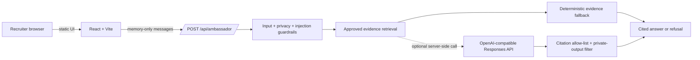

# ResumeBeyond

**Beyond the Static Resume**

ResumeBeyond is an evidence-grounded visual resume for **Asim Aslah P M**, positioned for **Machine Learning Engineer - LLM Applications & Evaluation** roles. It pairs a recruiter-first portfolio with **Mini Byte**, a privacy-aware AI ambassador that answers only from an approved source registry.

> Building intelligent, reliable, and privacy-aware AI systems.

## What is implemented

- Recruiter-first 60-second scan with one target role and three evidence-backed capabilities
- Two complete visual directions: the selected recruiter-first experience at `/` and the character-led portfolio evolution at `/directions/evolution`
- Six relevance-ordered project narratives with problem, contribution, approach, outcome, status, technologies, and source IDs
- Mini Byte multi-turn recruiter chat with deterministic retrieval, optional server-side model generation, citations, section links, reset, and mobile controls
- Unsupported-claim, private-data, prompt-injection, output-leakage, timeout, request-size, and rate-limit defenses
- No chat database, cookies, analytics, local/session storage, or prompt/response logging
- Privacy-safe downloadable public resume with LinkedIn and GitHub contact routes only
- 56 automated ambassador evaluations plus desktop and 390 px browser QA
- Replit configuration, GitHub Actions, security/privacy/evaluation documentation, and release gates

## Architecture



The production process is a dependency-light native Node server. It serves the Vite bundle, security headers, health/SEO endpoints, and the ambassador API. The original Cloudflare Worker, D1 database, analytics, and feedback data are not connected.

## Technology

- React 19, TypeScript, Vite, Lucide
- Native Node.js HTTP server and built-in `fetch`
- Vitest evaluation and API integration suite
- Playwright browser specification for CI
- ReportLab-generated public resume

## Local development

Requirements: Node.js 22.13 or newer.

```bash
npm install
npm run dev
```

Open `http://localhost:3000`.

## Environment configuration

No secret is required for the evidence-based ambassador fallback.

```bash
cp .env.example .env
```

| Variable | Required | Purpose |
| --- | ---: | --- |
| `OPENAI_API_KEY` | No | Enables optional server-side model synthesis |
| `OPENAI_MODEL` | No | Defaults to `gpt-5-mini` |
| `OPENAI_BASE_URL` | No | Defaults to the OpenAI API base URL |
| `PUBLIC_SITE_URL` | No | Canonical public origin used by the dynamic sitemap after deployment |
| `PORT` | Replit assigns | Server port; defaults to `3000` locally |

Never prefix a model key with `VITE_`; browser-exposed variables are not safe for secrets.

## Quality commands

```bash
npm run typecheck
npm run lint
npm test
npm run check:privacy
npm run build
npm run test:e2e
```

Current measured results are recorded in [docs/EVALUATION.md](docs/EVALUATION.md). The authored Playwright suite is intended for CI; this workspace completed equivalent browser flows through the visible local browser because registry installation for the Playwright package was unavailable.

## Grounding and privacy

Every candidate claim Mini Byte can use has:

- a stable evidence ID;
- one or more approved public source IDs;
- a verified source URL and date;
- a bounded factual statement and excerpt;
- an associated portfolio section.

Retrieved text is treated as untrusted data, never instructions. Invented citations are rejected. Unsupported questions return exactly: **“I don't have verified information about that.”**

See [source registry](docs/SOURCES.md), [privacy design](docs/PRIVACY.md), [architecture](docs/ARCHITECTURE.md), and [security policy](SECURITY.md).

## Replit deployment

The `.replit` file builds with `npm install && npm run check` and runs the Node server on the platform-assigned port. Follow [docs/REPLIT_DEPLOYMENT.md](docs/REPLIT_DEPLOYMENT.md).

No public Replit URL is claimed yet. Replit Design comparison, Replit Agent refinement, deployment, and signed-out verification remain manual release gates.

## Project status

Code and local verification are ready for review. The repository is **not yet release-ready** until the pending manual Handshake and public Replit checks in [docs/HANDSHAKE_CHECKLIST.md](docs/HANDSHAKE_CHECKLIST.md) are completed.

## License

MIT. See [LICENSE](LICENSE).

