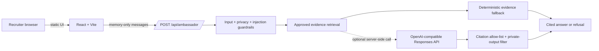

# ResumeBeyond

**Beyond the Static Resume**

ResumeBeyond is an evidence-grounded visual resume for **Asim Aslah P M**, positioned for **Machine Learning Engineer - LLM Applications & Evaluation** roles. It pairs a recruiter-first portfolio with **Mini Byte**, a privacy-aware AI ambassador that answers only from an approved source registry.

> Building intelligent, reliable, and privacy-aware AI systems.

## What is implemented

- Recruiter-first 60-second scan with one target role and three evidence-backed capabilities
- Two approved visual directions: recruiter-first at `/` and the premium character-led evolution at `/directions/evolution`
- Six relevance-ordered projects with bounded claims, status, contribution, technologies, and source IDs
- Mini Byte multi-turn chat with deterministic retrieval, optional server-side generation, citations, section links, reset, and mobile controls
- Exact unsupported refusal plus private-data, prompt-injection, output-leakage, timeout, request-size, and rate-limit defenses
- Traversal-safe static delivery with lexical and resolved-path containment, including symlink escape protection
- No chat database, cookies, analytics, browser chat persistence, or prompt/response logging
- Privacy-safe downloadable public resume with LinkedIn and GitHub contact routes only
- 82 ambassador, security, and HTTP tests plus Playwright desktop Chromium, 390 px mobile Chromium, and 390 px mobile WebKit projects
- Reproducible npm deployment, recursive dependency and credential scans, GitHub Actions, and Replit configuration

## Architecture



The production process is a dependency-light native Node server. It serves the Vite bundle, security headers, health/SEO endpoints, the public resume, and the ambassador API. The original Cloudflare Worker, D1 database, analytics, and feedback data are not connected.

## Technology

- React 19, TypeScript, Vite, Lucide
- Native Node.js HTTP server and built-in `fetch`
- Vitest evaluation/API/security suite
- Playwright browser suite
- npm lockfile and `npm ci` deployment builds

## Local development

Requirements: Node.js 22.13 or newer and npm 10 or newer. The tested package-manager version is recorded in `package.json`.

```bash
npm ci
npm run dev
```

Open `http://localhost:3000`.

## Environment configuration

No secret is required for the deterministic evidence fallback.

```bash
cp .env.example .env
```

| Variable | Required | Purpose |
| --- | ---: | --- |
| `OPENAI_API_KEY` | No | Enables optional server-side model synthesis |
| `OPENAI_MODEL` | No | Defaults to `gpt-5-mini` |
| `OPENAI_BASE_URL` | No | Defaults to the OpenAI API base URL |
| `PUBLIC_SITE_URL` | No | Canonical public origin for the dynamic sitemap |
| `PORT` | Replit assigns | Server port; defaults to `3000` locally |

Never prefix a model key with `VITE_`; browser-exposed variables are not safe for secrets.

## Quality commands

```bash
npm run typecheck
npm run lint
npm test
npm run check:privacy
npm run audit:dependencies
npm run build
npm run test:e2e
```

After a public Replit URL exists:

```bash
npm run verify:deployed -- https://your-public-replit-domain
```

Measured results and limitations are recorded in [docs/EVALUATION.md](docs/EVALUATION.md) and [docs/BROWSER_VERIFICATION.md](docs/BROWSER_VERIFICATION.md).

## Grounding and privacy

Every candidate claim Mini Byte can use has a stable evidence ID, approved public source IDs, a reviewed source URL/date, a bounded statement and excerpt, and an associated portfolio section. Retrieved text and recruiter messages are untrusted data, never instructions. Invented citations and private output are rejected. Unsupported questions return exactly: **“I don't have verified information about that.”**

See the [source registry](docs/SOURCES.md), [source privacy review](docs/SOURCE_PRIVACY_REVIEW.md), [privacy design](docs/PRIVACY.md), [architecture](docs/ARCHITECTURE.md), and [security policy](SECURITY.md).

## Replit deployment

The `.replit` file builds with `npm ci && npm run audit:dependencies && npm run check` and runs the Node server on the platform-assigned port. Follow [docs/REPLIT_DEPLOYMENT.md](docs/REPLIT_DEPLOYMENT.md).

No public Replit URL is claimed. Replit publication, signed-out verification, physical-device QA, and a timed recruiter review remain manual release gates.

## Project status

The Codex-addressable engineering work is implemented on PR #4. ResumeBeyond is **not v1.0.0 release-ready** until PR approval and the public/manual gates in [docs/HANDSHAKE_CHECKLIST.md](docs/HANDSHAKE_CHECKLIST.md) are completed. Draft release notes are in [docs/RELEASE_NOTES_v1.0.0.md](docs/RELEASE_NOTES_v1.0.0.md); no tag or release has been published.

## License

MIT. See [LICENSE](LICENSE).
